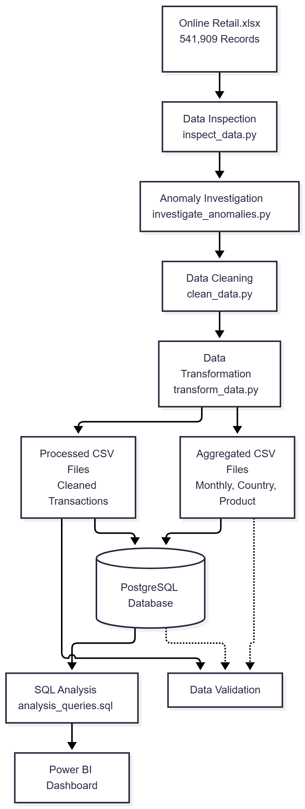

# Online Retail Data Engineering Project

An end-to-end data engineering project that transforms raw retail transaction data into structured, analysis-ready datasets using Python, Pandas, and PostgreSQL.

## Project Overview

This project demonstrates an end-to-end data engineering workflow using the [Online Retail Dataset](https://archive.ics.uci.edu/dataset/352/online+retail) from the UCI Machine Learning Repository.

The objective is to build a structured data pipeline that processes raw retail transaction data, improves data quality, generates analytical datasets, and stores the results in a PostgreSQL database.

The processed data is designed to support retail sales analysis and downstream business intelligence applications.

## Business Context

Retail transaction data contains valuable information about sales performance, customer purchasing activity, product demand, and geographical distribution.

However, raw transaction data requires proper inspection, cleaning, transformation, and validation before it can be reliably used for analysis.

This project addresses these requirements by developing a data pipeline that prepares raw retail data for structured SQL-based analysis.

## Tech Stack

| Technology | Purpose |
|---|---|
| Python 3.12 | Data processing and pipeline development |
| Pandas | Data cleaning and transformation |
| OpenPyXL | Excel dataset processing |
| SQLAlchemy | PostgreSQL connectivity |
| PostgreSQL | Relational database storage |
| pgAdmin 4 | Database management |
| SQL | Data analysis and validation |
| Git & GitHub | Version control and project documentation |

## Data Pipeline Architecture

The following diagram illustrates the data flow from raw data ingestion to database storage, validation, and analytical processing.



### Pipeline Stages

1. **Data Source** – Obtain raw transaction data from the UCI Online Retail dataset.
2. **Data Inspection** – Examine dataset structure, missing values, duplicates, and anomalies.
3. **Anomaly Investigation** – Investigate unusual transaction patterns and identify transaction categories.
4. **Data Cleaning** – Remove exact duplicate records and classify cancellation and adjustment transactions.
5. **Data Transformation** – Calculate sales values and generate aggregated datasets.
6. **Data Loading** – Load cleaned transaction data and analytical datasets into PostgreSQL.
7. **Data Validation** – Reconcile row counts, sales totals, and aggregation results.
8. **SQL Analysis** – Perform structured queries using PostgreSQL for retail sales analysis.

## Data Processing

The data processing workflow consists of three main operations.

### 1. Data Inspection & Investigation

- Inspect dataset dimensions and column data types.
- Identify missing values.
- Detect exact duplicate records.
- Investigate transaction anomalies.
- Examine cancellation and adjustment records.

### 2. Data Cleaning

The data cleaning process consists of several steps:

1. **Duplicate Removal:** Removed 5,268 identical duplicate records from the original dataset.
2. **Transaction Classification:** Identified cancellation transactions, stock adjustments, and accounting adjustments.
3. **Normal Sales Filtering:** Excluded cancellation and adjustment records, as well as transactions with non-positive quantities or unit prices.
4. **Sales Calculation:** Calculated `TotalSales` using `Quantity × UnitPrice`.
5. **Data Validation:** Verified that the cleaned sales dataset contains no duplicate records, non-positive quantities, or non-positive unit prices.

**Transaction Classification Results:**

| Category | Records |
|---|---:|
| Records after deduplication | 536,641 |
| Cancellation transactions | 9,251 |
| Stock adjustment transactions | 1,336 |
| Accounting adjustment transactions | 2 |
| Normal sales transactions | 524,878 |
| Records excluded from normal sales | 11,763 |

### 3. Data Transformation

Calculate transaction sales values using:

`Sales = Quantity × UnitPrice`

Generate analytical datasets grouped by:

- Monthly sales.
- Country-level sales.
- Product-level sales.
- Merchandise product sales, excluding DOT, POST, and M codes.

## Database Design

The project uses PostgreSQL to store structured transaction and aggregated sales data.

| Table | Description |
|---|---|
| `sales` | Cleaned transaction-level sales data |
| `monthly_sales` | Sales aggregation by month |
| `country_sales` | Sales aggregation by country |
| `product_sales` | Product aggregation by product code and description |
| `product_sales_merchandise` | Product aggregation excluding DOT, POST, and M codes |

## SQL Analysis

SQL queries are organized in `sql/analysis_queries.sql`.

The analysis focuses on:

- Monthly sales performance.
- Sales distribution by country.
- Product-level sales performance.
- Merchandise sales analysis.
- Sales reconciliation and data validation.

## Key Results

- Original dataset: 541,909 records
- Duplicate records removed: 5,268
- Records after deduplication: 536,641
- Normal sales transactions: 524,878
- Records excluded from normal sales: 11,763
- Countries represented: 38
- Product groups: 4,161
- Total sales: £10,642,110.804
- Merchandise sales: £10,280,009.884

## Data Validation

Sales reconciliation was performed to verify the consistency of the sales calculations.

| Category | Total Sales |
|---|---:|
| All sales | £10,642,110.804 |
| Merchandise sales | £10,280,009.884 |
| Excluded codes (DOT, POST, M) | £362,100.920 |
| Reconciliation difference | £0 |

The reconciliation confirms that the difference between total sales and merchandise sales is fully accounted for by the excluded transaction codes.

## Project Structure

```text
online-retail-data-engineering/
│
├── docs/
│   ├── images/
│   │   └── data_pipeline_architecture.png
│   └── data_pipeline_architecture.md
│
├── scripts/
│   ├── inspect_data.py
│   ├── investigate_anomalies.py
│   ├── clean_data.py
│   ├── transform_data.py
│   ├── test_connection.py
│   └── load_data.py
│
├── sql/
│   ├── create_tables.sql
│   └── analysis_queries.sql
│
├── outputs/
│   ├── country_sales.csv
│   ├── monthly_sales.csv
│   ├── online_retail_clean.csv
│   ├── online_retail_processed_all.csv
│   ├── product_sales.csv
│   └── product_sales_merchandise.csv
│
├── .gitignore
├── README.md
└── requirements.txt
```

The `.venv/` directory contains the local Python virtual environment and is excluded from version control.

The raw dataset `Online Retail.xlsx` is also excluded from version control.

## How to Run

### 1. Clone the repository

```bash
git clone <your-repository-url>
cd online-retail-data-engineering
```

### 2. Create a virtual environment

```powershell
python -m venv .venv
.venv\Scripts\Activate.ps1
```

### 3. Install dependencies

```bash
pip install -r requirements.txt
```

### 4. Prepare the dataset

Download the Online Retail dataset from the UCI Machine Learning Repository.

Place `Online Retail.xlsx` in the project root directory.

### 5. Run data inspection

```bash
python scripts/inspect_data.py
python scripts/investigate_anomalies.py
```

### 6. Run data cleaning and transformation

```bash
python scripts/clean_data.py
python scripts/transform_data.py
```

### 7. Set up PostgreSQL

- Create a PostgreSQL database named `online_retail_db`.
- Execute the `sales` table definition from `sql/create_tables.sql`.
- Configure the database connection in the loading script.
- Ensure database credentials are not committed to version control.

### 8. Test database connectivity

```bash
python scripts/test_connection.py
```

### 9. Load processed data

```bash
python scripts/load_data.py
```

### 10. Create analytical tables and execute SQL queries

Execute the remaining aggregation statements in `sql/create_tables.sql`.

Run the queries in `sql/analysis_queries.sql` to perform sales analysis and data validation.

## Additional Notes

- December 2011 represents a partial month because the dataset ends on December 9, 2011.
- Missing `CustomerID` values are retained in the transaction data.
- DOT, POST, and M are excluded from the merchandise-only analysis. This does not establish that every non-merchandise code has been identified.
- Total sales represent `Quantity × UnitPrice` for filtered normal sales records. They should not be interpreted as accounting revenue or profit.

## Data Source

**UCI Machine Learning Repository – Online Retail Dataset**

https://archive.ics.uci.edu/dataset/352/online+retail

